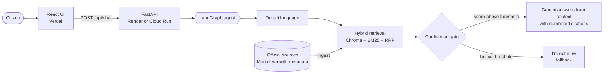
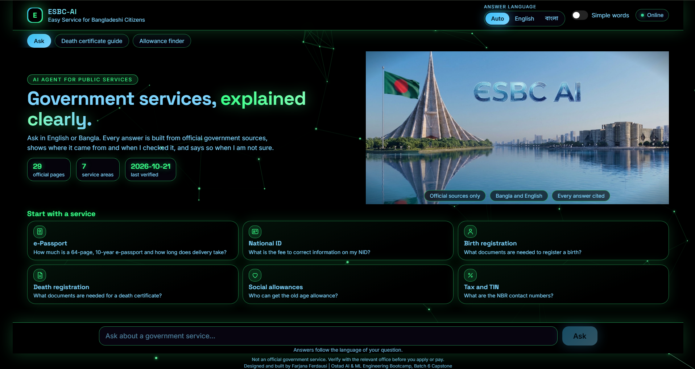
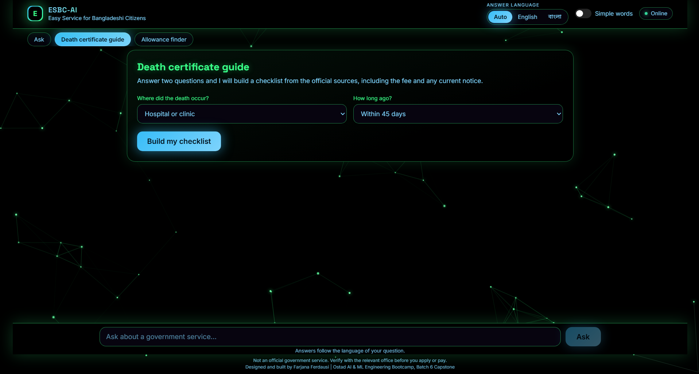
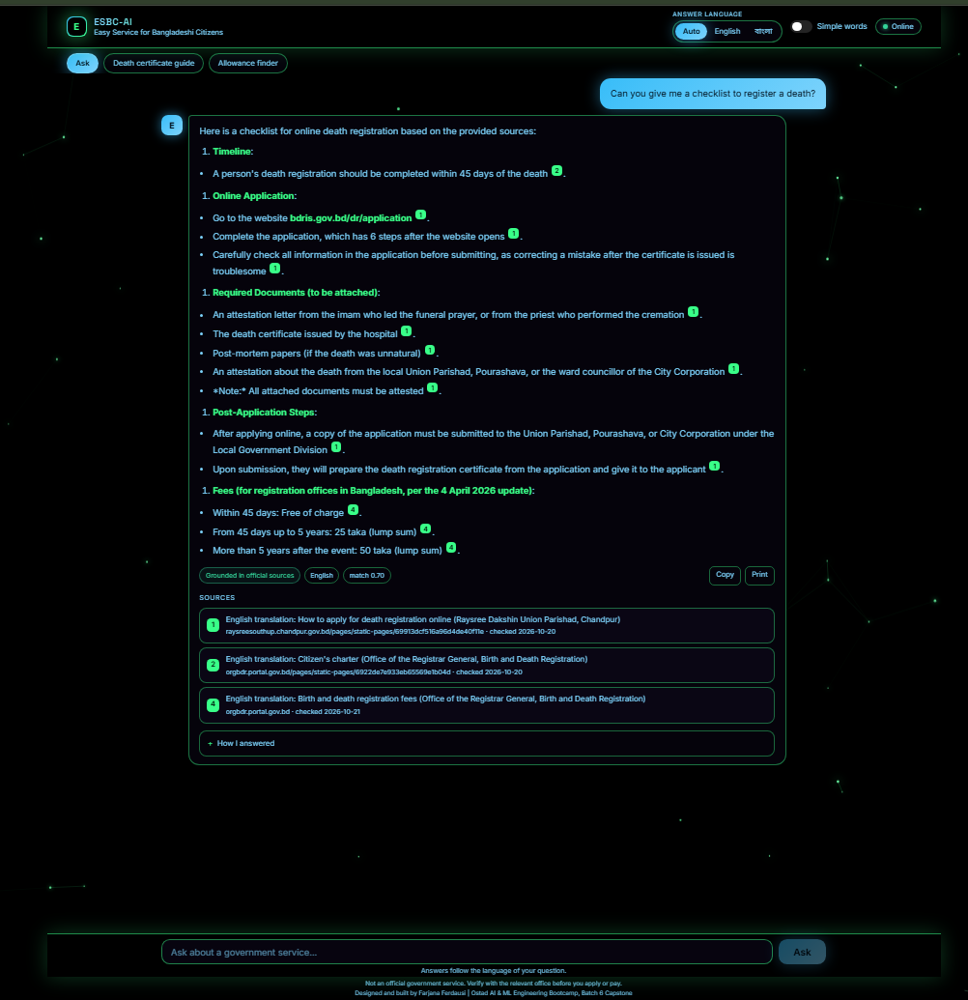

<div align="center">


# ESBC-AI

### Easy Service for Bangladeshi Citizens

A bilingual (Bangla and English), citation-grounded AI assistant that explains Bangladeshi government services. Every answer shows its official source and the date I checked it, and when the sources do not cover a question, the assistant says so instead of guessing.


**[Live app](LIVE_APP_URL)** | **[API docs](LIVE_API_URL/docs)** | **[Proposal](https://farjanaferdausi-cs50ai.github.io/ESBC-AI-Proposal/)** | **[Evaluation](docs/evaluation.md)**

</div>

---

## Why this project exists

Government services in Bangladesh are essential, but the information about them is scattered across many portals, changes over time, and is hard to follow for people with limited digital experience. A wrong fee, a missing document or a closed portal costs people time and money. I built ESBC-AI to answer these questions clearly, in the language the citizen uses, with a visible source for every claim.

## At a glance

| | |
|---|---|
| **Languages** | Bangla and English. The answer language follows the question language |
| **Grounding** | Answers come only from stored official pages, each with URL and verification date |
| **Honesty** | A confidence gate declines out-of-scope questions with "I'm not sure" |
| **Current notices** | A real maintenance notice on the BDRIS portal (19 to 25 October 2026) is stored and surfaced when relevant |
| **Retrieval** | Hybrid search: Gemini embeddings in Chroma plus BM25, fused with reciprocal rank fusion |
| **Agent** | A LangGraph state machine with an explicit, testable flow |
| **Modes** | Free-form Q&A, a death-certificate guide and an allowance finder |
| **Quality** | pytest suite and an evaluation harness for Bangla and English questions |

## Features

- **Ask anything** about the covered services and get a short answer with numbered citations and source cards.
- **Plain-language mode** rewrites the explanation in very simple words.
- **Death certificate guide** turns two answers into a step-by-step checklist with the fee and any current notice, and can be printed.
- **Allowance finder** checks age, sex and income against the official rules of social allowances.
- **Transparency:** every source card shows the page and the date it was checked. Older figures are flagged in the answer, for example the 2015 NID fee notice.
- **Server status** is shown in the interface, because free hosting sleeps when idle.

## Architecture



### How an answer is produced

1. **Knowledge base.** Official pages are stored as Markdown files in `data/sources/` with front matter: service, title, URL, date checked and language.
2. **Ingestion.** `python -m app.ingest` splits each file into overlapping chunks, embeds them with `gemini-embedding-001` (768 dimensions) and stores them in a persistent Chroma collection.
3. **Retrieval.** A question is embedded and searched densely and with BM25. The two rankings are merged with reciprocal rank fusion. Chunks of the same page are grouped into one numbered source.
4. **Gate.** If the best dense similarity is below `SCORE_THRESHOLD`, the model is not called and the assistant declines.
5. **Generation.** Gemini answers only from the numbered context, in the language of the question, and cites sources as [1], [2]. The prompt tells it to mention closures and deadlines, to state the year of older figures and to prefer newer sources.

## Knowledge base

| Service | Official pages used | Notes |
|---|---|---|
| Death registration | Registrar General citizen charter, a union parishad guide, BDRIS notice | The BDRIS portal was under maintenance when checked |
| Birth and death fees | Registrar General fee table (updated 4 April 2026) | Official fee schedule |
| Birth registration | Union parishad notice (7 September 2024) | Documents by age group |
| e-Passport | epassport.gov.bd fee and document pages | Fees updated 12 July 2026 |
| NID | Election Commission fee notice and NID portal | The fee notice dates from 2015 and is flagged as such |
| Social allowances (DSS) | Old age, widow, disadvantaged communities, serious disease support | Rules, amounts and documents |
| Tax | NBR and e-TIN portal pages | Contact numbers only, no tax rules yet |

Only official `.gov.bd` pages are used. News sites, blogs and forums are deliberately excluded. Where an official page could not be read, the assistant has no answer and says so.

## Evaluation

The harness in `eval/run_eval.py` asks a fixed set of 29 questions (answerable and out of scope, in Bangla and English) and writes `docs/evaluation.md`. It reports retrieval hit rate, answer accuracy, refusal accuracy and the Bangla versus English gap. Results are in [docs/evaluation.md](docs/evaluation.md).

| Metric | Result |
|---|---|
| Retrieval hit rate (top 5) | EVAL_RETRIEVAL |
| Answer accuracy | EVAL_ANSWER |
| Refusal accuracy on out-of-scope questions | EVAL_REFUSAL |

The checks are keyword based, not an LLM judge, so they are a lower bound on quality and not a substitute for human review.

## Screenshots

| Home | Death certificate guide | Answer with sources |
|---|---|---|
|  |  |  |

## Tech stack

| Layer | Technology |
|---|---|
| Frontend | React 18, Vite, plain CSS |
| Backend | FastAPI, Pydantic, Uvicorn |
| Agent | LangGraph |
| Retrieval | ChromaDB, rank-bm25, reciprocal rank fusion |
| Models | Google Gemini (generation) and gemini-embedding-001 (embeddings) |
| Hosting | Render (API), Vercel (UI), Dockerfile for Google Cloud Run |
| Quality | pytest, evaluation harness, `scripts/doctor.py` self-check |

## Repository layout

```
backend/app/     config, embeddings, ingest, search, agent, main (API)
backend/tests/   offline unit tests with a deterministic fake embedding
data/sources/    official source documents, one folder per service
frontend/        React application
eval/            evaluation harness
scripts/         doctor.py environment and data self-check
docs/            evaluation report, screenshots and the final report
```

## Run it locally

```bash
git clone https://github.com/farjanaferdausi-cs50ai/ESBC-AI.git
cd ESBC-AI/backend
python -m venv .venv
source .venv/Scripts/activate          # Windows Git Bash. On Linux or macOS: source .venv/bin/activate
pip install -r requirements.txt
echo "GOOGLE_API_KEY=your_key_here" > .env
python -m app.ingest                   # build the knowledge base
python -m uvicorn app.main:app --port 8000
```

Frontend, in a second terminal:

```bash
cd frontend
npm install
npm run dev
```

Set `VITE_API_URL` to the address of a deployed API. Without it the UI talks to `http://127.0.0.1:8000`.

**Self-check:** from the repository root run `python scripts/doctor.py` (add `--live` to test the Gemini calls).

## API

| Method | Path | Purpose |
|---|---|---|
| GET | `/health` | Liveness check |
| GET | `/api/meta` | Knowledge base size, services and last verification date |
| POST | `/api/chat` | Body `{"message": "...", "plain_mode": false}`. Returns the answer, language, confidence flag, best retrieval score and the list of sources |

## Tests

```bash
cd backend
python -m pytest -q
```

The suite covers language detection, chunking, front matter parsing, the API contract and error handling, hybrid retrieval with a fake embedding, grouping of sources and the refusal path. No network access or API key is needed.

## Deployment

- **API on Render:** the included `render.yaml` blueprint builds the index during the build and starts Uvicorn. Set `GOOGLE_API_KEY` in the dashboard.
- **UI on Vercel:** import the repository, set the root directory to `frontend` and add `VITE_API_URL`.
- **Google Cloud Run:** the `Dockerfile` runs the same API. The service builds its index in the background on start, so the port opens immediately and `/api/meta` reports when the index is ready.

## Design decisions

- **Gemini embeddings instead of a local model.** A Windows application-control policy blocked PyTorch on my development machine, and free hosting has little memory. An embedding API keeps the image small and the deployment simple. This differs from the BGE-M3 or multilingual-e5 option named in my proposal.
- **Hybrid retrieval.** Dense search handles paraphrases and cross-language questions, BM25 handles exact numbers and names such as fees and form names. Reciprocal rank fusion needs no tuning.
- **Gate before generation.** Declining is cheaper and safer than a confident wrong answer about a fee or a deadline.
- **Official sources only, with dates.** Each document carries the date I checked it, so answers can be audited and refreshed.
- **Lightweight evaluation.** I used keyword-based checks instead of RAGAS to keep the harness small, offline-friendly for retrieval and easy to explain.

## Limitations and roadmap

What this version does not do yet:

- The knowledge base is small and only as good as the official pages I could read. Tax rules, TIN registration steps and disability allowances are not covered yet.
- The BDRIS portal was under maintenance when I checked it, so the live online application steps could not be verified from the portal itself.
- The NID fee table is from a 2015 notice, and the assistant says so.
- Planned, not implemented: guided form filling with validation, OCR of uploaded documents, downloadable application packets, a memory vault, payment simulation and a larger evaluation set.

## Disclaimer

- **Educational project.** ESBC-AI is a capstone project for the Ostad AI & ML Engineering Bootcamp. It is not an official government service and is not affiliated with any government agency.
- **Verify before acting.** Answers come from official pages on the dates shown in each citation. Fees, deadlines and procedures change. Confirm with the official portal or office before you apply, pay or submit documents.
- **Not legal advice.** The assistant gives general information only.
- **AI can make mistakes.** It is designed to answer only from its sources, but errors are still possible.
- **Privacy.** The application does not store conversations. Questions are sent to the Google Gemini API to produce answers, so please do not enter identification numbers, passwords or other sensitive data.

## Author

Designed and built by **Farjana Ferdausi** as the Module 27 capstone of the Ostad AI & ML Engineering Bootcamp, Batch 6.
